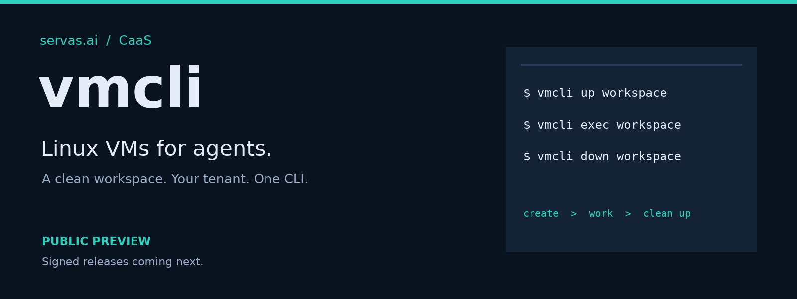

<p align="center"></p>

<h1 align="center">vmcli</h1>
<p align="center"><strong>Linux virtual machines for agents and development tasks.</strong><br>The command-line client for servas.ai CaaS.</p>
<p align="center">


<a href="docs/agents.md"></a>
</p>
<p align="center"><a href="docs/installation.md">Install</a> · <a href="docs/usage.md">Usage</a> · <a href="docs/agents.md">Agents</a> · <a href="docs/configuration.md">Configuration</a> · <a href="docs/security.md">Security</a> · <a href="docs/troubleshooting.md">Troubleshooting</a></p>

**Public preview — there is no public vmcli release to install yet.** This repository prepares the customer documentation, agent skills and public verification key. The public API, sign-in and SSH route are still awaiting implementation and acceptance. Do not use existing internal builds as a substitute.

vmcli is designed to lease a Linux VM in your tenant, run a task, transfer files and remove the VM when the task finishes. The public service will provide tenant limits and a lease expiry through your authorized account.

## Intended customer experience

- Download a signed binary from [Releases](https://github.com/servas-ai/vmcli-public/releases), without a GitHub account or access to another repository.
- Sign in through [auth.servas.ai](https://auth.servas.ai) with the role supplied for your tenant.
- Use the public CaaS API and guest connection without a VPN, Tailscale or API key.
- Create a VM, work in it and explicitly remove your own VM afterward.

These are release acceptance criteria, not claims about an available public service. Device-code login and environment selection are planned; their commands will be documented when released.

## Workflow preview

The lifecycle syntax below is documented for the forthcoming public release. **It is not a setup or installation guide.** First wait for a signed release and a completed public access acceptance, then follow [installation](docs/installation.md).

```sh
vmcli whoami --json
vmcli up workspace-example --size s --ttl 1h --task "example task" --json
# Continue only after confirming that this task created the VM.
vmcli exec workspace-example -- 'uname -s'
vmcli down workspace-example
```

Use a unique name for each task. Never delete a VM that belongs to another task. See the complete [usage flow](docs/usage.md) and [agent rules](docs/agents.md).

## Documentation

| Guide | What it covers |
| --- | --- |
| [Installation](docs/installation.md) | Preview status, client platforms and release verification requirements |
| [Usage](docs/usage.md) | VM lifecycle, commands and file transfer |
| [Agents](docs/agents.md) | Structured output, ownership and cleanup |
| [Configuration](docs/configuration.md) | Public endpoint and account configuration roadmap |
| [Security](docs/security.md) | Required isolation gates and release trust |
| [Troubleshooting](docs/troubleshooting.md) | Known preview limits and support |
| [Agent skill](skills/vmcli/SKILL.md) | Contract to copy into an agent harness |
| [Agent snippet](skills/AGENTS.snippet.md) | Short workspace instructions |
| [Examples](examples/README.md) | Lifecycle examples for the future release |
| [Verification key](keys/README.md) | Public Ed25519 key and signature format |
| [Changelog](CHANGELOG.md) | Public distribution changes |
| [Release notes](release-notes/README.md) | What is available and what remains gated |

## Status and scope

| Area | Status |
| --- | --- |
| Documentation, agent skills and public release key | Available in this preview |
| Signed public release binaries | Not published |
| Public endpoint `https://api.caas.servas.ai` | Target endpoint; public access not accepted |
| Account sign-in, tenant mapping and public SSH | Pending implementation and acceptance |
| Linux clients (amd64, arm64), macOS clients (amd64, arm64) | Planned; no public installer yet |
| Windows client | Later; not supported in this preview |
| Customer VM operating systems | Linux only for the first release |
| Customer-operated server components | Future planning |

This repository contains documentation, skills, public keys and artwork. Future releases will add compiled binaries and signed checksums. Product source code and signing secrets are not distributed here.

## License and support

See [LICENSE](LICENSE) for binary usage and documentation permissions. Report security issues privately as described in [SECURITY.md](SECURITY.md). Account and service questions: [servas.ai](https://servas.ai).

Copyright © 2026 servas.ai. All rights reserved.
